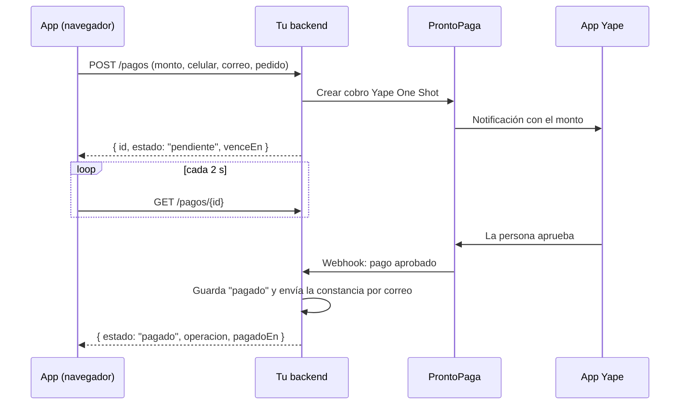

# Integración real: Yape One Shot con ProntoPaga

Hoy la app funciona en **modo demo**: simula el cobro en el navegador y no cobra nada. Este documento explica qué falta para cobrar de verdad.

## Cómo funciona el flujo

1. En **Mi pedido**, la persona toca **Comprar con Yape** y escribe su celular y su correo.
2. La app le pide a **tu backend** que cree el cobro.
3. El backend llama a **ProntoPaga** (Yape One Shot) con el celular y el monto.
4. **Yape** le envía una notificación al celular con el monto ya puesto. La persona la abre y la aprueba, sin código.
5. ProntoPaga le avisa al backend que el pago se aprobó (webhook). El backend marca el pago como pagado y **envía la constancia al correo**.
6. Mientras tanto, la app consulta el estado cada 2 segundos, y también apenas la persona vuelve desde Yape. Cuando el estado es `pagado`, muestra **¡Pago realizado!** con el número de operación y el código de recojo.



## Por qué hace falta un backend

Las credenciales de ProntoPaga **no pueden ir en la app**: cualquiera que abra la página podría leerlas. Además, el backend:

- calcula el total con **sus propios precios**, sin confiar en el monto que envía el navegador;
- recibe el webhook de ProntoPaga y verifica su firma;
- guarda cada pago para poder responder la consulta de estado;
- envía la constancia por correo, salvo que ProntoPaga la envíe (por confirmar).

Opción sugerida: una Supabase Edge Function más una tabla `pagos` (id, pedido, monto, celular, correo, estado, operación, fechas).

## Contrato que espera la app

La app ya llama a estas rutas en modo `api`. La URL base se configura en `js/payments.js` (`apiBase`).

| Método y ruta | Cuerpo | Respuesta |
|---|---|---|
| `POST /pagos` | `{ monto, moneda: "PEN", telefono, correo, pedido, descripcion }` | `{ id, estado: "pendiente", venceEn }` (fecha ISO) |
| `GET /pagos/{id}` | — | `{ id, estado, operacion?, pagadoEn?, motivo? }` |
| `POST /pagos/{id}/cancelar` | — | `{ id, estado: "cancelado" }` |

- `estado` puede ser: `pendiente`, `pagado`, `rechazado`, `vencido` o `cancelado`.
- `telefono` son 9 dígitos que empiezan con 9, sin el +51.
- Ante un error, el backend responde un código 4xx o 5xx con `{ "mensaje": "texto para mostrar" }`.
- El backend debe permitir CORS para el dominio de la app (por ejemplo `https://ferdango.github.io`).

## Activar el modo real

En `js/payments.js`:

```js
const CONFIG = {
  modo: 'api',
  apiBase: 'https://<tu-proyecto>.supabase.co/functions/v1/yape',
  ...
};
```

Con `modo: 'api'`, la app ya no muestra el aviso de demo ni los botones de simulación.

## Qué pedirle a ProntoPaga

- Credenciales de **sandbox** y de producción.
- La documentación de **Yape One Shot**:
  - cómo crear el cobro con celular y monto;
  - qué estados devuelve y cuánto dura la solicitud;
  - cómo es el webhook y cómo se verifica su firma;
  - cómo consultar el estado de un cobro.
- Si ellos envían la constancia por correo o si debe enviarla tu backend.
- Comisiones, montos mínimo y máximo, y tiempos de abono.

Ningún dato de su API está confirmado todavía: no hay documentación pública. Por eso la app solo habla con tu backend, y el backend es el único que conoce a ProntoPaga.

## Datos personales

El celular y el correo son datos personales (Ley 29733). Úsalos solo para el cobro y la constancia, guárdalos en el backend con acceso restringido y menciónalos en la política de privacidad de la app.
